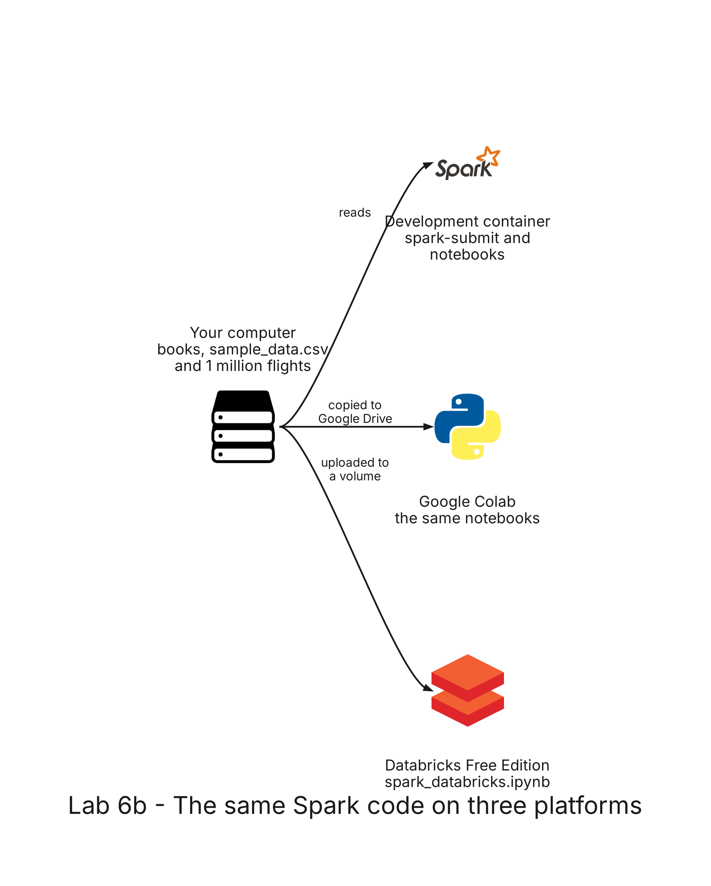

# README

- [README](#readme)
  - [Summary](#summary)
  - [Setup](#setup)
    - [Prerequisites](#prerequisites)
    - [Step 1: Count the words with spark-submit](#step-1-count-the-words-with-spark-submit)
    - [Step 2: WordCount step by step](#step-2-wordcount-step-by-step)
    - [Step 3: DataFrames, SQL and UDFs](#step-3-dataframes-sql-and-udfs)
    - [Step 4: The same notebooks in Google Colab](#step-4-the-same-notebooks-in-google-colab)
    - [Step 5: Spark on Databricks](#step-5-spark-on-databricks)
  - [Remove](#remove)

---

## Summary

`Lab 6b: the same Spark code on three platforms` runs Apache Spark on your computer, in Google Colab and in Databricks Free Edition. You count the words of a set of books from Project Gutenberg with a script and `spark-submit`, follow the WordCount step by step with RDDs and write it again with DataFrames and Spark SQL, work with a small CSV file using DataFrames, SQL and user-defined functions, run the same notebooks in Google Colab, and run the flights of lab 6 and the WordCount in Databricks, where the RDD API does not exist.

The books and the CSV file are in the folder `datasets` of the repository: 4 books in English in `gutenberg-en`, 8 books in Spanish in `gutenberg-es`, and `sample_data.csv`, with 33 users of mobile phones. It needs no AWS account and deploys nothing.



---

## Setup

### Prerequisites

The development container must be running, with the image of [lab 6](../06-spark-local/README.md#prerequisites): Java 17, PySpark, pandas and the Jupyter kernel. Steps 1 to 3 run only in the container.

Step 4 needs a Google account, and step 5 an account of Databricks Free Edition: sign up at <https://login.databricks.com/?dbx_source=docs&intent=CE_SIGN_UP>. Databricks creates a workspace with serverless compute for you.

All the commands run in the terminal of the development container, in the repository folder.

### Step 1: Count the words with spark-submit

`wordcount.py` reads a set of text files, counts each word and writes the count as one CSV file, with the most frequent words first. A word is a run of letters in lowercase: `The`, `the` and `the,` are the same word.

```bash
spark-submit --master 'local[*]' labs/06b-spark/wordcount.py
```

Expected: after some warning lines of Spark, the script prints the totals of the four English books and the ten most frequent words, and the folder where it wrote the count:

```text
Lines: 80286, words: 792256, distinct words: 26019
         the    44334
         and    28039
          of    23565
          to    22371
           a    15164
          in    13808
        that    13220
           i    11909
          it    10350
          he    10136
Wrote the count to labs/shared/output/lab06b/wordcount-en
```

The folder has a file `_SUCCESS` and a single CSV file, `part-00000-` followed by an id, with the header `word,count`.

The same script counts any other files: only the arguments change. Count the Spanish books:

```bash
spark-submit --master 'local[*]' labs/06b-spark/wordcount.py \
  --input 'datasets/gutenberg-es/*.txt' --output labs/shared/output/lab06b/wordcount-es
```

Expected: `Lines: 109892, words: 1043214, distinct words: 48528`, and the ten words `de` (49785), `y`, `que`, `la`, `el`, `en`, `á` (20813), `los`, `no` and `se`. The seventh one, `á`, is the preposition `a` with the accent that the Spanish of these old editions put on it.

On a Spark cluster the command is the same, with the master of the cluster and paths that the cluster can read.

### Step 2: WordCount step by step

Open `labs/06b-spark/wordcount.ipynb` in JupyterLab (<http://localhost:8888>) or in Visual Studio Code, as in [lab 6](../06-spark-local/README.md#step-2-open-the-notebook-and-start-spark), and run the cells one at a time, from the top.

The first cell detects that it runs in the development container and prints `Development container | data in ../../datasets`. The second one starts Spark and prints `Spark 4.1.1` and the number of cores.

- **Read the books:** `Partitions: 4`, one for each book, and the first lines of `The Adventures of Sherlock Holmes`. `lines.count()` gives `80286`.
- **WordCount step by step:** `flatMap` gives the words, `map` a pair `(word, 1)` for each one and `reduceByKey` adds the pairs of each word. The ten most frequent words, splitting on spaces:

  | word | count |
  | ---- | ----- |
  | the  | 41442 |
  | and  | 26069 |
  | of   | 22766 |
  | to   | 21538 |
  | a    | 14467 |
  | in   | 12850 |
  | that | 11735 |
  | I    | 10066 |
  | he   | 8641  |
  | his  | 8566  |

- **Clean the words:** `words("The whale, the WHALE! 1851")` gives `['the', 'whale', 'the', 'whale']`. With the clean words there are 26019 distinct words and `the` has 44334, the same count as step 1. `whale` appears 1246 times, `ahab` 517 and `sherlock` 102.
- **The same count with DataFrames:** the same ten words and counts as step 1, and the comparison with the RDD version gives `True`: both count every word the same. The plan has two `Exchange` steps: `hashpartitioning(word, 200)`, the shuffle that brings together the rows of each word, and `rangepartitioning`, for the final sort.
- **Spark SQL:** the same table.
- **The Spanish books:** the same ten words as step 1.
- **Save the count:** the folder `labs/shared/output/lab06b/wordcount-en` has `_SUCCESS` and a single CSV file.

Run the last cell, `spark.stop()`.

### Step 3: DataFrames, SQL and UDFs

Open `labs/06b-spark/dataframes.ipynb` and run the cells one at a time, from the top. The first two cells are the same as in step 2.

- **Read the CSV file:** `Rows: 33 | columns: 5`. `inferSchema` gives `ratings`, `age` and `family` as `integer`, `experience` as `double` and `mobile` as `string`.
- **Filter:** 5 users have a Vivo phone, and 2 of them have more than 10 years of experience.
- **Distinct values and groups:** 5 brands. The count by brand:

  | mobile  | count |
  | ------- | ----- |
  | MI      | 8     |
  | Apple   | 7     |
  | Oppo    | 7     |
  | Samsung | 6     |
  | Vivo    | 5     |

- **SQL on a DataFrame:** `SHOW TABLES` lists `phones`, a temporary view. The average rating by brand:

  | mobile  | avg_ratings | users |
  | ------- | ----------- | ----- |
  | Vivo    | 4.2         | 5     |
  | Samsung | 4.17        | 6     |
  | MI      | 3.5         | 8     |
  | Apple   | 3.43        | 7     |
  | Oppo    | 2.86        | 7     |

- **User-defined functions:** the first row, a Vivo user of 32 years with 9 years of experience and a rating of 3, gets `Low Price`, `senior`, `yrs_left` 68 and `product` 27.0.
- **Duplicates and columns:** `Rows: 33 | without duplicates: 26`.
- **Save the results:** `sample_csv` has `_SUCCESS` and one CSV file, `sample_parquet` has `_SUCCESS` and one Parquet file, and reading the Parquet back gives `26`.

Run the last cell, `spark.stop()`.

### Step 4: The same notebooks in Google Colab

Colab runs a notebook on a machine of Google, with Python but without Java or Spark. The first cell of each notebook installs them there, and reads the data from your Google Drive.

1. In Google Drive, create the folder `big-data-labs` in **My Drive**, and upload to it the folder `datasets` of the repository.
2. Open <https://colab.research.google.com>, choose **File**, then **Upload notebook**, and upload `labs/06b-spark/wordcount.ipynb`.
3. Run the first cell. Colab asks for permission to access your Google Drive: accept it. The cell installs Java 17 and PySpark 4.1.1 and prints `Google Colab | data in /content/gdrive/MyDrive/big-data-labs/datasets`.
4. Run the rest of the cells.

Expected: the same results as step 2, except the number of cores. The count is saved in `big-data-labs/output/lab06b/wordcount-en` of your Google Drive. Do the same with `dataframes.ipynb`: the same results as step 3.

<!-- TO CONFIRM after the first run in Colab: the time the first cell takes and the number of cores Colab gives. -->

### Step 5: Spark on Databricks

The compute of Databricks Free Edition is serverless: the notebook talks to Spark through Spark Connect, there is no `SparkContext` and the RDD API is not supported, so the RDD WordCount of step 2 does not run there. DataFrames and Spark SQL work the same. There is no web UI of Spark either: the query profile takes its place.

Generate 1 million flights, the same ones that labs 9 and 10 use:

```bash
python3 labs/shared/generator/generate_flights.py --flights 1000000 --output labs/shared/output/lab06b/airline
```

Expected: `Wrote 1000000 flights to labs/shared/output/lab06b/airline`. The folder `flights` has 9 CSV files, about 88 MB in total.

1. In Databricks, click **Workspace** in the sidebar, then the kebab menu at the upper right, **Import**, and import `labs/06b-spark/spark_databricks.ipynb`.
2. Open the notebook and run the first code cell. It creates the schema `big_data_labs` and the volume `lab06b` in the catalog `workspace`, and prints `/Volumes/workspace/big_data_labs/lab06b`. If your workspace has no catalog `workspace`, change `CATALOG` in the cell to one that Catalog Explorer lists.
3. In Catalog Explorer, open the volume `lab06b` and click **Create directory** three times to create `flights`, `airports` and `gutenberg-en`.
4. Upload the files: in the sidebar, click **New**, then **Add or upload data** and **Upload files to a volume**. Choose the 9 files of `labs/shared/output/lab06b/airline/flights` and, as **Destination volume**, the directory `flights` of the volume. Do the same with `airports.csv` of `labs/shared/output/lab06b/airline/airports` and the 4 files of `datasets/gutenberg-en`.
5. Run the rest of the cells, one at a time.

<!-- TO CONFIRM after the first run in Databricks: that the catalog is named workspace, and the name of the error of spark.sparkContext. -->

Expected:

- **Upload the files:** `flights 9 files`, `airports 1 files` and `gutenberg-en 4 files`.
- **Spark Connect:** the module of `spark` is a Spark Connect client, and `spark.sparkContext` fails: on Spark Connect it raises `PySparkAttributeError`.
- **Read the flights:** `1000000`.
- **Transformations are lazy:** the cell finishes at once, and `late.count()` gives `287786`.
- **The shuffle** and **Spark SQL:** the five origins with more flights, the same in both:

  | origin | count  |
  | ------ | ------ |
  | BOG    | 238643 |
  | MDE    | 166204 |
  | CTG    | 118497 |
  | CLO    | 117858 |
  | BAQ    | 72940  |

- **A join with a small table:** 9 countries, from Colombia with 908175 flights to Brazil with 6541.
- **A window function:** the first day of `AND`, `2026-01-01`, has 8906.0 delay minutes, and the running total of the fifth day is 38732.0.
- **WordCount with DataFrames:** the same ten words and counts as step 1.
- **Save a table:** the table `flights_by_country` of the schema `big_data_labs`, with Colombia, United States and Panama first. Catalog Explorer shows it in the schema.

---

## More examples

    
[06b-spark/](06b-spark/)
    

## Remove

In Databricks, run the cell of **Remove** at the end of the notebook. It deletes the table, the volume with its files and the schema.

In Google Drive, delete the folder `big-data-labs`, or only its `output` folder if you want to keep the data for another session.

In the development container, delete the files of the lab:

```bash
rm -rf labs/shared/output/lab06b
```
