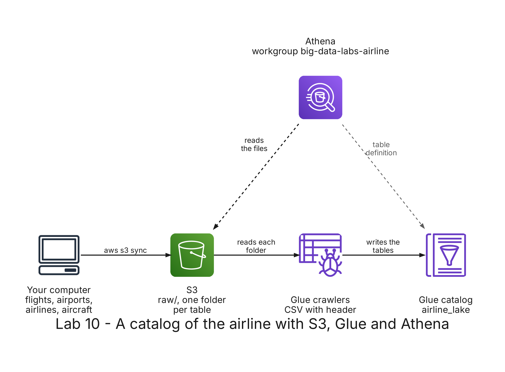

# README

- [README](#readme)
  - [Summary](#summary)
  - [Setup](#setup)
    - [Prerequisites](#prerequisites)
    - [Step 1: Generate the flights](#step-1-generate-the-flights)
    - [Step 2: Deploy the stack](#step-2-deploy-the-stack)
    - [Step 3: Upload the four tables to S3](#step-3-upload-the-four-tables-to-s3)
    - [Step 4: Catalog the tables with a crawler](#step-4-catalog-the-tables-with-a-crawler)
    - [Step 5: Explore the tables in Athena](#step-5-explore-the-tables-in-athena)
    - [Step 6: Join the four tables](#step-6-join-the-four-tables)
    - [Step 7: Partition the flights by month](#step-7-partition-the-flights-by-month)
  - [Remove](#remove)

---

## Summary

`Lab 09b: a catalog of the airline with S3, Glue and Athena` stores the flights, airports, airlines and aircraft of the airline in Amazon S3, lets an AWS Glue crawler describe them as four tables in the Glue Data Catalog, and queries and joins them with SQL in Amazon Athena. Then it uploads the flights again, one folder per month, and compares how much data Athena reads from each copy.

It has its own stack, with its own bucket, Glue database and Athena workgroup, and does not need the stacks of the other labs.



---

## Setup

### Prerequisites

The development container must be running, with your credentials in `.envs/aws.env` and `.envs/sls.env`: see [Environment variables](../../README.md#environment-variables) in the root README. The stack deploys to the region `us-east-1`, so set `AWS_DEFAULT_REGION=us-east-1` in `.envs/aws.env`.

All the commands run in the terminal of the development container, in the repository folder. Set the names the commands use:

```bash
ACCOUNT=$(aws sts get-caller-identity --query Account --output text)
BUCKET=big-data-labs-airline-$ACCOUNT
echo $BUCKET
```

### Step 1: Generate the flights

```bash
python3 labs/shared/generator/generate_flights.py --flights 1000000 --output labs/shared/output/lab09b
```

It writes four folders in `labs/shared/output/lab09b`, one per table:

- `flights/`: 1 million flights in 9 CSV files, one per month from January to September 2026, about 88 MB in total.
- `airports/`: `airports.csv`, with 20 airports.
- `airlines/`: `airlines.csv`, with 8 airlines.
- `aircraft/`: `aircraft.csv`, with 610 aircraft.

Expected: `Wrote 1000000 flights to labs/shared/output/lab09b`.

### Step 2: Deploy the stack

```bash
(cd labs/09b-s3-glue-athena/serverless/catalog && serverless deploy)
```

It creates the stack `big-data-labs-lab09b-catalog`:

- the S3 bucket `big-data-labs-airline-` followed by your account id;
- the Glue database `airline_lake`;
- a CSV classifier that tells the crawlers that the first line of each file is its header;
- two crawlers: `big-data-labs-airline-tables`, for the four tables, and `big-data-labs-airline-partitions`, for step 7;
- the IAM role of the crawlers;
- the Athena workgroup `big-data-labs-airline`, which saves the results of the queries in the bucket.

The classifier is needed for `airlines.csv`: its two columns are text, and when every column of a file is text the built-in CSV classifier of Glue cannot tell the header from the data. It then names the columns `col1`, `col2` and reads the header as one more row.

### Step 3: Upload the four tables to S3

The `raw/` zone keeps the files as they arrive, one folder per table:

```bash
aws s3 sync labs/shared/output/lab09b/flights s3://$BUCKET/raw/flights/
aws s3 sync labs/shared/output/lab09b/airports s3://$BUCKET/raw/airports/
aws s3 sync labs/shared/output/lab09b/airlines s3://$BUCKET/raw/airlines/
aws s3 sync labs/shared/output/lab09b/aircraft s3://$BUCKET/raw/aircraft/
aws s3 ls s3://$BUCKET/raw/ --recursive --human-readable --summarize
```

Expected: 12 objects: the 9 files of the flights and the files of the airports, the airlines and the aircraft, about 88 MiB in total.

### Step 4: Catalog the tables with a crawler

```bash
aws glue start-crawler --name big-data-labs-airline-tables
aws glue get-crawler --name big-data-labs-airline-tables --query Crawler.State --output text
```

Repeat the second command until the state is `READY` again. The crawler has one include path per folder of `raw/`, so it writes one table for each folder in the database `airline_lake`, named after the folder. List the tables:

```bash
aws glue get-tables --database-name airline_lake --query 'TableList[].Name' --output text
```

Expected: `aircraft`, `airlines`, `airports` and `flights`.

<!-- TO CONFIRM after the first run: the time the crawler takes and the type it gives each column of flights (DESCRIBE flights in step 5). -->

### Step 5: Explore the tables in Athena

Open the Athena console in the region N. Virginia (`us-east-1`): <https://console.aws.amazon.com/athena/>. In the query editor, choose the workgroup `big-data-labs-airline` (top right) and the database `airline_lake`. Copy `queries/01_tables.sql` from Visual Studio Code and paste it in the editor. Highlight the statement you want to run and click **Run**.

- **Statement 1:** the four tables of step 4.
- **Statements 2 and 3:** the columns of `flights` and `airlines`, with the type the crawler gave each one. The crawler guesses each type from the values: check them before you trust them. The names of the columns come from the first line of each file.
- **Statement 4:** 1000000 flights, 20 airports, 8 airlines and 610 aircraft.
- **Statement 5:** the 8 airlines, from `AND` (Andes Air) to `SUR` (Sur Express). None of the rows is the header of the file.

Below each result, Athena shows the time the query took and the **Data scanned**: the bytes of S3 it read, which is what Athena charges for, with a minimum of 10 MB per query.

### Step 6: Join the four tables

Run the statements of `queries/02_joins.sql` one at a time. They convert the columns they use with `CAST` and `try_cast`, so they work whatever type the crawler chose: a cancelled flight has an empty `actual_departure`, and `try_cast` turns it into `NULL` instead of failing.

- **Statement 1:** flights, cancelled flights and average departure delay of each airline, joined with `airlines` for the name. Expected: 8 rows. The first one is Andes Air, with 220291 flights, 3420 cancelled and 9.7 minutes of average delay, and the last one is Llanos Connect, with 69976 flights.
- **Statement 2:** the ten routes with more flights, joined twice with `airports` for the city of the origin and of the destination. Expected: Bogota to Medellin is first, with 57974 flights, and Medellin to Bogota second, with 57866.
- **Statement 3:** flights and seats offered by aircraft model, joined with `aircraft`, without the cancelled flights. Expected: 6 models. ATR72 has the most flights, 188604, and A330 the most seats, 42459250.
- **Statement 4:** the average departure delay of each airline by month, the same calculation as the Glue job of lab 9. Expected: the first row is `AND`, `2026-01`, 26172 flights and 9.9 minutes, the same as the output of that job.

### Step 7: Partition the flights by month

Upload the flights again, now one folder per month named `month=` followed by the month, and run the second crawler:

```bash
for FILE in labs/shared/output/lab09b/flights/*.csv; do
  MONTH=$(basename $FILE .csv | sed 's/flights-//')
  aws s3 cp $FILE s3://$BUCKET/raw/flights_by_month/month=$MONTH/
done
aws s3 ls s3://$BUCKET/raw/flights_by_month/
aws glue start-crawler --name big-data-labs-airline-partitions
```

Expected: 9 folders, from `month=2026-01/` to `month=2026-09/`. Wait until the crawler is `READY` again, as in step 4, and list the tables: there is a new one, `flights_by_month`. It has the same columns as `flights` plus `month`, a partition column that comes from the names of the folders, not from the files.

Run the statements of `queries/03_partitions.sql` one at a time:

- **Statement 1:** the 9 partitions of `flights_by_month`, one per folder.
- **Statements 2 and 3:** the flights of March by airline, first from `flights` and then from `flights_by_month`. Expected: the same 8 rows in both, from `AND` with 24344 flights to `SUR` with 13225.

Compare the **Data scanned** of statements 2 and 3. The first one reads the 9 files of `flights`, about 88 MB, to find the March flights. The second one filters on the partition column, so Athena reads only the folder `month=2026-03/`, a file of about 10 MB: it skips the other 8 months without opening them, as Spark did in lab 7.

<!-- TO CONFIRM after the first run: the Data scanned of statements 2 and 3 of 03_partitions.sql. -->

---

## Remove

Empty the bucket, which also holds the results of the Athena queries, remove the stack, delete its deployment bucket and the local files:

```bash
aws s3 rm s3://$BUCKET --recursive
(cd labs/09b-s3-glue-athena/serverless/catalog && serverless remove)
aws s3 rb s3://us-east-1.cfn.lab09b-catalog.big-data-labs.$ACCOUNT.deploys
rm -r labs/shared/output/lab09b
```

Removing the stack deletes the database `airline_lake` with its tables, the crawlers, the classifier and the workgroup. The logs of the crawlers stay in CloudWatch, in the log group `/aws-glue/crawlers`.
