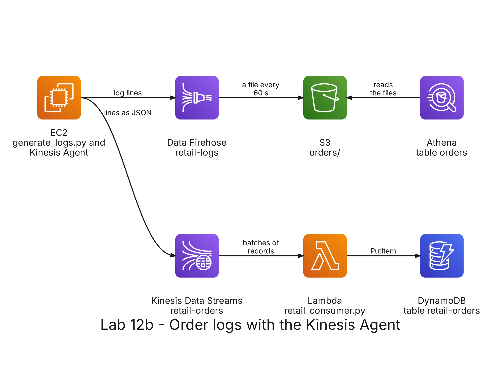

# README

- [README](#readme)
  - [Summary](#summary)
  - [Setup](#setup)
    - [Prerequisites](#prerequisites)
    - [Step 1: Deploy the stack](#step-1-deploy-the-stack)
    - [Step 2: Copy the lab files to the bucket](#step-2-copy-the-lab-files-to-the-bucket)
    - [Step 3: Connect to the server](#step-3-connect-to-the-server)
    - [Step 4: Send the logs to Firehose](#step-4-send-the-logs-to-firehose)
    - [Step 5: Look at the files in S3](#step-5-look-at-the-files-in-s3)
    - [Step 6: Query the logs in Athena](#step-6-query-the-logs-in-athena)
    - [Step 7: Send the logs to Firehose and to a data stream](#step-7-send-the-logs-to-firehose-and-to-a-data-stream)
    - [Step 8: Read the data stream](#step-8-read-the-data-stream)
    - [Step 9: Query the orders in DynamoDB](#step-9-query-the-orders-in-dynamodb)
    - [Step 10: Query the logs again](#step-10-query-the-logs-again)
  - [Remove](#remove)

---

## Summary

`Lab 12b: order logs with the Kinesis Agent` collects the log files that an application server writes. A program on an EC2 instance writes the order lines of an online store as log files, and the Amazon Kinesis Agent, installed on the same instance, sends each new line to Amazon Data Firehose, which writes it to S3, where you query it with Athena. Then the agent also turns each line into JSON and sends it to a Kinesis data stream, where a Lambda function writes it to a DynamoDB table and a second consumer reads it from your computer.

Labs 5 and 12 send the events from a program that calls the AWS API. Here the program only writes files, and the agent watches the folder and sends what is new: the application does not know about Kinesis.

It has its own stack, with the server, the delivery stream, the data stream, the table, the function and the bucket, and does not need the stacks of the other labs.



The data are the 406829 order lines with a customer of the Online Retail data set, the sales of an online store of the United Kingdom between December 2010 and December 2011, in `datasets/online-retail/online-retail.csv.gz`: Chen, D. (2015), Online Retail, UCI Machine Learning Repository, <https://doi.org/10.24432/C5BW33>, CC BY 4.0.

| File                                   | What it does                                                                                                             |
| -------------------------------------- | ------------------------------------------------------------------------------------------------------------------------ |
| `generator/generate_logs.py`           | Writes the next lines of the data set as a log file in `/var/log/retail`, one order line per log line, separated by tabs |
| `agent/agent-firehose.json`            | Configuration of the agent: every new line of `/var/log/retail/*.log` to Firehose                                        |
| `agent/agent-firehose-and-stream.json` | The same, plus every new line as JSON to the data stream                                                                 |
| `reader/read_stream.py`                | A consumer that reads the data stream from your computer and prints each record                                          |
| `serverless/retail/retail_consumer.py` | The Lambda function: converts each record to a DynamoDB item and writes it                                               |
| `serverless/retail/ec2.yml`            | The server: Amazon Linux 2023, with the Kinesis Agent installed when it starts                                           |
| `queries/`                             | The table of the logs in Athena and the queries                                                                          |

---

## Setup

### Prerequisites

The development container must be running, with your credentials in `.envs/aws.env` and `.envs/sls.env`: see [Environment variables](../../README.md#environment-variables) in the root README. The stack deploys to the region `us-east-1`, so set `AWS_DEFAULT_REGION=us-east-1` in `.envs/aws.env`.

This lab needs the paid plan of your AWS account, as lab 5 does. The server is created in the default VPC of the region. Check that it exists:

```bash
aws ec2 describe-vpcs --filters Name=is-default,Values=true --query 'Vpcs[].VpcId' --output text
```

Expected: the id of a VPC, such as `vpc-0a1b2c3d`. If the output is empty, create the default VPC with `aws ec2 create-default-vpc`.

All the commands run in the terminal of the development container, in the repository folder, unless the step says that they run on the server.

### Step 1: Deploy the stack

```bash
(cd labs/12b-kinesis/serverless/retail && serverless deploy)
```

It creates the stack `big-data-labs-lab12b-retail`:

- the S3 bucket `big-data-labs-retail-` followed by your account id;
- the Firehose stream `big-data-labs-retail-logs`, which writes to `orders/` in the bucket every 60 seconds or 5 MiB;
- the Kinesis data stream `big-data-labs-retail-orders`, with 1 shard;
- the DynamoDB table `big-data-labs-retail-orders`, with the customer as the partition key and the invoice and the product as the sort key;
- the Lambda function `big-data-labs-retail-orders-consumer`, which reads the data stream;
- the EC2 instance `big-data-labs-retail-logs-server`, of type `t3.micro`, with a role that can send to the two streams and read the folder `lab/` of the bucket;
- the Glue database `big_data_labs_retail` and the Athena workgroup `big-data-labs-retail`;
- the roles of Firehose, the function and the server.

When the instance starts, it installs the Kinesis Agent (`aws-kinesis-agent`) and creates the folder `/var/log/retail`. Set the names that the next steps use:

```bash
ACCOUNT=$(aws sts get-caller-identity --query Account --output text)
BUCKET=big-data-labs-retail-$ACCOUNT
echo $BUCKET
```

### Step 2: Copy the lab files to the bucket

The server reads the generator, the data set and the configurations of the agent from the folder `lab/` of the bucket:

```bash
aws s3 cp labs/12b-kinesis/generator/generate_logs.py s3://$BUCKET/lab/
aws s3 cp datasets/online-retail/online-retail.csv.gz s3://$BUCKET/lab/
aws s3 cp labs/12b-kinesis/agent/ s3://$BUCKET/lab/ --recursive
aws s3 ls s3://$BUCKET/lab/
```

Expected: 4 files, `agent-firehose-and-stream.json`, `agent-firehose.json`, `generate_logs.py` and `online-retail.csv.gz`.

### Step 3: Connect to the server

Open the EC2 console in the region N. Virginia (`us-east-1`): <https://console.aws.amazon.com/ec2/>. In **Instances**, select `big-data-labs-retail-logs-server`, click **Connect**, choose the tab **Session Manager** and click **Connect**. A terminal opens in the browser, with no SSH key and no open port: the role of the server includes the permissions of Session Manager. If the tab says that the instance is not connected yet, wait one or two minutes after the deploy and try again.

The commands of steps 3, 4 and 7 run in that terminal. Check the agent and copy the lab files to `/opt/lab12b`:

```bash
rpm -q aws-kinesis-agent
BUCKET=big-data-labs-retail-$(aws sts get-caller-identity --query Account --output text)
sudo aws s3 cp s3://$BUCKET/lab/ /opt/lab12b/ --recursive
ls /opt/lab12b
```

Expected: the version of the agent, such as `aws-kinesis-agent-2.0.x`, and the 4 files of step 2.

<!-- TO CONFIRM after the first run: the version that rpm -q prints. -->

### Step 4: Send the logs to Firehose

The agent reads its configuration from `/etc/aws-kinesis/agent.json`. The first one has one flow: every new line of the files `/var/log/retail/*.log` goes to the Firehose stream `big-data-labs-retail-logs`. Install it and start the agent:

```bash
cat /opt/lab12b/agent-firehose.json
sudo cp /opt/lab12b/agent-firehose.json /etc/aws-kinesis/agent.json
sudo systemctl restart aws-kinesis-agent
systemctl is-active aws-kinesis-agent
```

Expected: `active`. Write the first 1000 order lines as a log file:

```bash
sudo python3 /opt/lab12b/generate_logs.py --lines 1000
```

Expected: `Wrote 1000 lines, from line 1 of 406829, to /var/log/retail/` followed by the date and time of the file. The generator saves the position in `/opt/lab12b/last_line.txt`, so the next run continues at line 1001. Look at the file and at the log of the agent:

```bash
head -3 /var/log/retail/*.log
sudo tail -5 /var/log/aws-kinesis-agent/aws-kinesis-agent.log
```

Expected: the first line of the file has `554065`, `22755`, `SMALL PURPLE BABUSHKA NOTEBOOK`, `12`, `5/22/2011 10:39`, `0.85`, `18287` and `United Kingdom`, separated by tabs. The log of the agent reports, every 30 seconds or so, the records that it parsed and sent.

<!-- TO CONFIRM after the first run: the text of the progress lines of the agent log. -->

### Step 5: Look at the files in S3

Firehose keeps the records in a buffer and writes them as a file about 60 seconds after they arrive. Wait two minutes and, in the development container, list the folder `orders/`:

```bash
aws s3 ls s3://$BUCKET/orders/ --recursive --human-readable
```

Expected: one or more files under `orders/` followed by the date and the hour in UTC, such as `orders/2026/11/06/21/`, with about 82 KiB in total. Firehose names the folders with the time when the records arrived, not with the dates of the orders, which are from 2011.

### Step 6: Query the logs in Athena

Open the Athena console in the region N. Virginia: <https://console.aws.amazon.com/athena/>. Choose the workgroup `big-data-labs-retail` and the database `big_data_labs_retail`. Copy `queries/01_orders_table.sql`, replace `YOUR_BUCKET` with the name of your bucket in the two places where it appears, and run it. The table reads the tab-separated lines, and partition projection finds the folders of each hour without a crawler.

Run the statements of `queries/02_explore.sql` one at a time:

- **Statement 1:** `1000` order lines.
- **Statement 2:** `85039B` (S/4 IVORY MINI ROSE CANDLE IN BOWL) with 120 units, then `21399` and `85039A` with 96, `79302M` with 80 and `21824` with 72.
- **Statement 3:** customer `18283` spent the most, 2094.88 in 16 invoices, then `18287` with 1837.28 and `18272` with 1452.65.
- **Statement 4:** 19 return lines in 6 invoices, for -216.42.

### Step 7: Send the logs to Firehose and to a data stream

The second configuration keeps the flow to Firehose and adds a second flow from the same files to the data stream `big-data-labs-retail-orders`. In that flow, the option `CSVTOJSON` splits each line at the tabs and turns it into JSON with the names of `customFieldNames`. Back in the terminal of the server:

```bash
cat /opt/lab12b/agent-firehose-and-stream.json
sudo cp /opt/lab12b/agent-firehose-and-stream.json /etc/aws-kinesis/agent.json
sudo systemctl restart aws-kinesis-agent
sudo python3 /opt/lab12b/generate_logs.py --lines 500
```

Expected: `Wrote 500 lines, from line 1001 of 406829`. The agent sends the 500 lines to both streams. The Lambda function starts reading the data stream within seconds.

### Step 8: Read the data stream

The Lambda function is one consumer of the stream. `read_stream.py` is another one, independent of it, that reads from your computer. In the development container:

```bash
python3 labs/12b-kinesis/reader/read_stream.py --from-start --seconds 10
```

Expected: `Reading 1 shard(s) of big-data-labs-retail-orders from TRIM_HORIZON`, then one line per record, with the end of its sequence number, the invoice, the customer, the quantity, the price and the product, starting with `559813`, `18272`, `24 x 1.45` and `HOMEMADE JAM SCENTED CANDLES`, and at the end `Read 500 records`. Reading does not remove the records: the function read the same ones, and the stream keeps them for 24 hours.

### Step 9: Query the orders in DynamoDB

Count the items of the table:

```bash
aws dynamodb scan --table-name big-data-labs-retail-orders --select COUNT
```

Expected: `"Count": 499`. The 500 lines have 499 different keys: line `546561`, product `22456` (NATURAL SLATE CHALKBOARD LARGE) of customer `18260` appears twice in the data set, and the second write replaced the first item. Query the lines of one customer by its partition key:

```bash
aws dynamodb query --table-name big-data-labs-retail-orders \
  --key-condition-expression 'customer_id = :c' \
  --expression-attribute-values '{":c": {"N": "18272"}}' --select COUNT
```

Expected: `"Count": 85`.

### Step 10: Query the logs again

The 500 lines of step 7 also went to Firehose. Wait two minutes and run the statements of `queries/02_explore.sql` again:

- **Statement 1:** `1500` order lines, now in more files.
- **Statement 2:** `22151` (PLACE SETTING WHITE HEART) and `84879` with 144 units, `21212` with 130, `85039B` with 120 and `22993` with 108.
- **Statement 3:** customer `18272` spent the most, 3078.58 in 6 invoices, then `18260` with 2643.2 and `18259` with 2338.6.
- **Statement 4:** 35 return lines in 16 invoices, for -438.35.

---

## Remove

Stop the agent in the terminal of the server, if it is still open, so that it does not send more records:

```bash
sudo systemctl stop aws-kinesis-agent
```

In the development container, empty the bucket, which also holds the results of the Athena queries, remove the stack and delete its deployment bucket:

```bash
aws s3 rm s3://$BUCKET --recursive
(cd labs/12b-kinesis/serverless/retail && serverless remove)
aws s3 rb s3://us-east-1.cfn.lab12b-retail.big-data-labs.$ACCOUNT.deploys
```

Removing the stack terminates the server and deletes the streams, the table, the function, the database with its table and the workgroup. The logs of the function stay in CloudWatch, in the log group `/aws/lambda/big-data-labs-retail-orders-consumer`.
